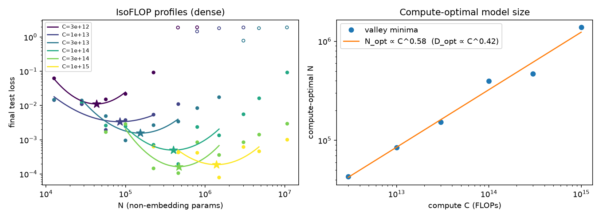
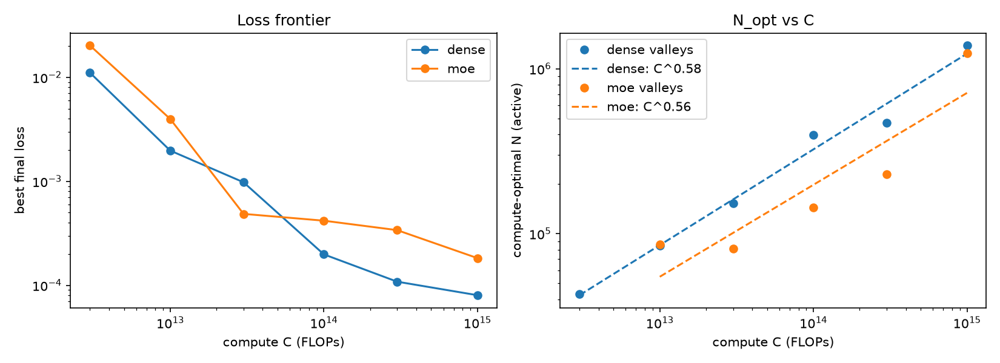

# 10M-Transformer

A small decoder-only transformer, written from scratch in JAX/Flax NNX, that learns multi-digit integer addition. It is then used as a test bed for **compute-optimal scaling (IsoFLOP) experiments**, comparing a dense MLP against a top-k **Mixture-of-Experts** feed-forward layer.

The name comes from the base configuration in `config.py` (`L=6, D=384`), which has roughly 10M parameters and is trained on exhaustive 3-digit addition. The scaling sweeps use 10-digit addition and a ladder of models from about 13k to 10M non-embedding parameters.

## The task

Each example is a fixed-width string of the form `a+b=c`. Operands are right-aligned and leading zeros become spaces:

```
'      4821+  93017722=   93022543'
```

- Vocabulary: 13 tokens (`0`–`9`, `+`, `=`, space).
- Sequence length: `3n + 3` for `n`-digit operands; the answer has `n + 1` digits.
- Loss: next-token cross-entropy, masked so that only the **answer tokens** count (`make_mask` in `config.py`).

There are two data sources:

| Function | Used by | Description |
|---|---|---|
| `gen_data` (`data_gen.py`) | `train.py`, `evaluation.py` | Lists every `a+b` pair for small `n`, shuffles them and holds out 5% as a test split. |
| `sample_batch` (`data_gen.py`) | pilot and sweeps | A jitted sampler that draws random `n`-digit operands on the fly and computes the sum digit by digit with `lax.scan`. |

## Model

`transformer.py` holds the model:

- Learned token and positional embeddings
- Pre-LayerNorm blocks with causal multi-head attention (head dim 16 by default) and a GELU feed-forward layer (`F = 4D`)
- Final LayerNorm and an untied output head
- AdamW (β = 0.9/0.95, weight decay 0.1), global-norm clipping at 1.0, and a warmup-cosine schedule (5% warmup, decaying to 10% of the peak learning rate)

**MoE variant** (`arch="moe"`): every MLP is replaced by `E` experts (default 8) with a softmax router and top-k gating (default k=1, with gates renormalised when k>1). Tokens are sorted by expert and dispatched with `jax.lax.ragged_dot`, so nothing is padded and no capacity factor is needed. A Switch-style load-balancing loss (`E · Σ fᵢ·pᵢ`, weighted by `aux_factor=0.01`) is added to the training loss.

## Repository layout

| File | Purpose |
|---|---|
| `config.py` | `make_config(...)` builds a config dict; `Config` holds the base ~10M model |
| `tokenizer.py` | Character-level tokenizer for the 13-token vocabulary |
| `data_gen.py` | Exhaustive dataset and on-the-fly batch sampler (`python data_gen.py` self-checks the sampler) |
| `transformer.py` | Model, MoE layer, loss, optimizer and jitted train step |
| `train.py` | Trains the base model on exhaustive addition and saves a checkpoint |
| `checkpoint.py` | Orbax save and load into `checkpoints/` |
| `evaluation.py` | Greedy autoregressive decoding, exact-match accuracy broken down by number of carries, and a list of failures |
| `sweep.py` | `train_run` (one token-budgeted run), parameter counting, CSV and JSON logging |
| `pilot.py` | Pilot runs: 3 model sizes × 2 learning rates at 50M tokens |
| `run_sweep.py` | IsoFLOP sweep over a model-size ladder and a set of compute budgets |
| `run_all.sh` | Queues the dense and MoE sweeps (written for Colab) |
| `test_moe.py` | Tests for the MoE layer |
| `plots.py` | Builds the figures in `figures/` from the files in `results/` |
| `results/` | `runs.csv` (all sweep runs) and `pilot/*.json` (pilot loss curves) |

## Setup

```bash
pip install -r requirements.txt   # flax, optax, orbax-checkpoint, pandas, matplotlib
```

JAX is installed as a dependency of Flax. For GPU or TPU support, install the matching `jax[cuda]` or `jax[tpu]` wheel.

## Usage

### Train and evaluate the base model

```bash
python train.py        # 3-digit addition, 2 epochs; saves checkpoints/addition/
python evaluation.py   # exact-match accuracy on the held-out split, broken down by carry count
```

### Tests

```bash
python test_moe.py
```

The tests check that:

- the `ragged_dot` MoE matches a dense einsum reference for k=1 and k=2
- the router receives gradients
- parameter counts are correct
- loss goes down in short smoke-training runs for both architectures

### Scaling experiments

```bash
python pilot.py                        # pilot curves -> results/pilot/
DRY_RUN=1 python run_sweep.py          # print the sweep plan and an estimated runtime
ARCH=dense python run_sweep.py         # run the dense sweep -> results/runs.csv
ARCH=moe   python run_sweep.py         # run the MoE sweep
python plots.py                        # draw figures/ and print fitted valleys
```

`run_sweep.py` is configured with environment variables:

| Variable | Default | Meaning |
|---|---|---|
| `ARCH` | `dense` | `dense` or `moe` |
| `SEED` | `0` | Seed for the run |
| `BUDGETS` | `3e12,1e13,3e13,1e14,3e14,1e15` | Compute budgets C, in FLOPs |
| `MAX_TOKENS` | `4e8` | Skip runs that would need more tokens than this |
| `DRY_RUN` | unset | Set to `1` to print the plan and exit |

For each `(L, D)` on the ladder and each budget C, the token count is `C / (6N)`. Runs with fewer than 200 steps, or with more tokens than `MAX_TOKENS`, are skipped. The learning rate follows a power law in N, `3e-3 · (N / 56k)^-0.276`, clipped to the range [7e-4, 3e-3]. This rule came from the pilot runs. The sweep can be resumed: runs already logged in `results/runs.csv` are skipped.

Two conventions to keep in mind when reading results:

- **N** means *active* non-embedding parameters. For MoE, `N_total` also counts the inactive experts.
- Reported loss is the answer-token cross-entropy on 20k held-out sampled problems.

## Results

The sweep covers 10-digit addition at six compute budgets from 3e12 to 1e15 FLOPs, with 106 runs logged in `results/runs.csv`.



For each budget, `plots.py` fits a parabola in log-log space around the loss minimum. Runs that never leave the initial loss plateau (loss ≥ 0.5, shown as hollow markers) are excluded from the fit. The fitted minima give:

| | N_opt scaling | D_opt scaling |
|---|---|---|
| Dense | N_opt ∝ C^0.58 | D_opt ∝ C^0.42 |
| MoE (8 experts, top-1) | N_opt ∝ C^0.56 | — |



- **Dense** has the lower loss at most budgets. At 1e15 FLOPs the best dense run (L=4, D=176, about 1.5M parameters) reaches a loss of about 8e-5.
- **MoE** is ahead in the middle of the range (around 3e13 FLOPs). At higher budgets its loss stops improving as fast. At the same active-parameter count, its compute-optimal models are smaller than the dense ones.
- **Throughput:** on the smallest models, MoE trains more slowly per token.

Other figures:

- `figures/isoflop_moe.png`: IsoFLOP profiles for the MoE runs
- `figures/pilot_curves.png`: loss-vs-tokens curves from the pilot runs that set the learning rate

## Notes

- `CKPT_DIR` in `checkpoint.py` and `LOG` in `run_all.sh` contain paths for Google Colab or Google Drive. Change them before running elsewhere.
- Positional information comes only from learned absolute embeddings. RoPE is listed as a TODO in `AttentionBlock`.
